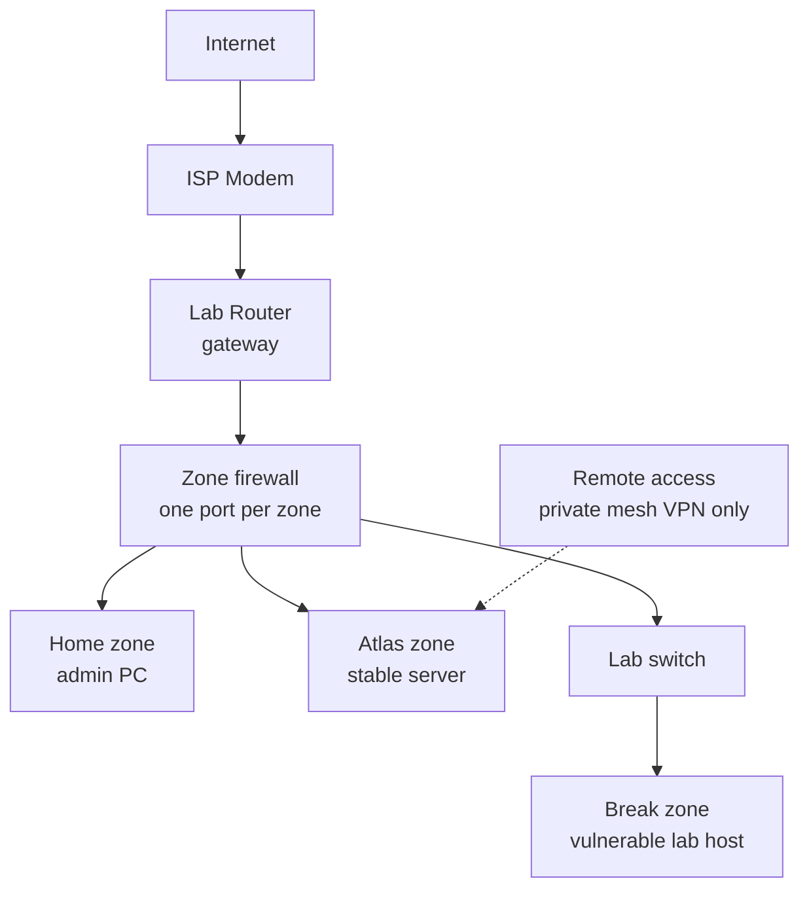

# janus-lab
🌏 Atlas + ☄️ Break Blog

A two-server home lab, built and documented in public: one stable server for
everyday services, one deliberately vulnerable lab, hard-separated so the lab
can never reach anything that matters.

## The two halves

- **Atlas** — stable, always-on. Virtualisation, media, music, private chat,
  backups, remote access over a private mesh VPN. Built for reliability and
  privacy, for me and a handful of invited family and friends.
- **Break** — deliberately vulnerable. A security lab for attack and defence
  practice, rebuilt from scripts. Constantly broken, constantly rebuilt.

The core rule of the project: **Break must never reach Atlas, personal
devices, or any management interface.** Every design decision follows from it.

## Status

**Phase 0 — Decisions and setup.** ✅ Complete.
**Phase 1 — Hardware bring-up.** 🚧 In Progress.

**Where this is heading (week 20):** Atlas replaces my paid streaming and
subscription services and is in real use, and I use Break at least twice a week
to feed security research, public write-ups, and hands-on practice.

## What is in this repo

- **`docs/`**: Phase write-ups, hardware inventory, and lessons learned.
- **`runbooks/`**: Step-by-step guides (e.g., SMART checks, console resets).
- **`configs/`**: Sanitized configuration files.
- **`detections/`**: Wazuh and Splunk rules (coming in later phases).
- **`scripts/`**: Ansible or Terraform for lab rebuilds (coming later).

## What is deliberately not here

Addresses, hostnames, tailnet names, MAC addresses, serial numbers, firmware
versions, credentials, budget figures, and hardware model numbers. The
authoritative record is private; everything here is rewritten from it, never
copied.

Findings are published only after they are fixed and retested. Detections and
lessons are published; working exploit chains are not.

## Why this exists

A portfolio of method and evidence — including the mistakes — for entry-level
security work, and a lab I actually use rather than a rack of idle hardware.

## Architecture

Three zones, one firewall, one port per zone. Remote access is a private mesh
VPN only — no port forwards, nothing exposed to the internet.

**Break is isolated by design.** No path exists from the Break zone to Atlas,
to the home zone, or to any management interface — and none will be added.
Isolation is re-tested after every network change.