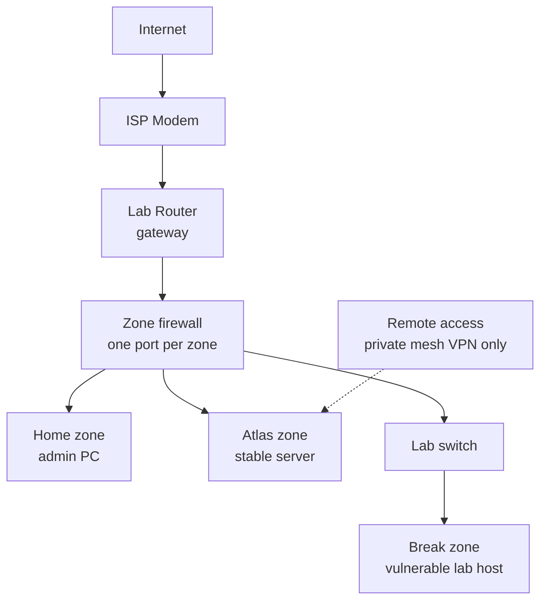

# Architecture

The core design rule of Janus Lab is: **Break must never reach Atlas, personal devices, or any management interface.**

To enforce this, the network is divided into zones, with a dedicated firewall managing the traffic between them. Remote access is handled exclusively through a private mesh VPN, meaning **zero ports are exposed to the internet**.

## Target Design

Three zones, one firewall, one port per zone.

*   **Home Zone:** The admin PC.
*   **Atlas Zone:** The stable server.
*   **Break Zone:** The vulnerable lab host, connected via a Lab Switch.

No route exists from the Break zone to Atlas, the Home zone, or any management interface. Isolation is re-tested after every network change.